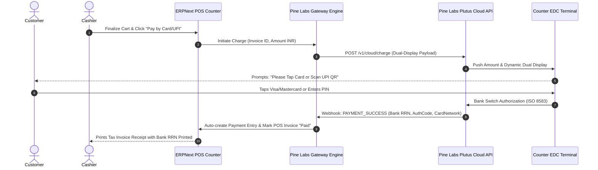

# ERPNext POS Pine Labs & EDC Card Terminal Payment Gateway

[](https://www.python.org/)
[](https://frappe.io)
[](https://erpnext.com)
[](LICENSE)
[](https://www.pcisecuritystandards.org/)
[]()

Production-grade hardware and cloud payment integration for **ERPNext POS retail counters**, connecting **Pine Labs Plutus Cloud** and **Android EDC Smart Swipe Terminals** (Verifone, Ingenico, Pax) with zero-touch real-time ledger reconciliation.

---

## 🎯 The Real-World Client Problem

In high-volume retail stores (supermarkets, luxury apparel, electronics outlets, and pharmacy chains), POS checkout operations suffer from critical bottlenecks:
1. **Cashier Manual Typing Errors:** Cashiers manually type invoice totals into card swipe machines. A bill of ₹5,420 frequently gets entered as ₹542 or ₹54,200, causing revenue loss or severe customer disputes.
2. **Slow Checkout Queues:** During rush hours, double-entry (once on ERPNext POS, once on the EDC terminal) doubles transaction time, leading to abandoned shopping carts.
3. **Closing Shift Reconciliation Nightmare:** At store closing, store managers spend 2+ hours comparing paper EDC batch settlement slips against ERPNext POS Closing Vouchers to locate mismatched card transactions.

**This engine completely automates the loop:** The moment a cashier clicks "Pay", the bill total is securely pushed to the EDC terminal's customer-facing screen. Once tapped/swiped, the terminal auto-reports Bank RRN, authorization codes, and card type back to ERPNext, instantly generating a reconciled Payment Entry.

---

## 🏗️ System Architecture & Data Flow



---

## ⚙️ Key Enterprise Features

- **Direct Cloud-to-EDC Dispatch:** Eliminates local USB/Serial COM port driver instabilities by communicating directly over HTTPS with the Pine Labs Plutus Cloud Gateway.
- **Hardware Dual-Display Support:** Automatically streams transaction item summaries, taxes, and final payable amounts to the EDC terminal's customer-facing color LCD screen.
- **Full Card & UPI Telemetry:** Captures Bank Reference Retrieval Number (RRN), approval authorization codes, payment mode (Credit/Debit/UPI/EMI), card network (Visa, Mastercard, RuPay, Amex), and masked card digits (`XXXX-XXXX-XXXX-1234`).
- **Idempotency Protection:** Generates unique cryptographic transaction tokens per invoice attempt to strictly prevent duplicate card debits on network retry.
- **Automated POS Shift Batch Reconciliation:** Matches EDC end-of-day batch settlement files against the cashier's ERPNext POS Closing Shift Voucher, flagging any offline discrepancies automatically.

---

## 📂 Project Structure

```
erpnext-pos-pine-labs-payment-gateway/
├── pine_pos/
│   ├── __init__.py           # Package version & module exports
│   └── engine.py             # Core Plutus Cloud engine & data classes
├── tests/
│   ├── __init__.py
│   └── test_pine_pos.py      # Full unit test suite (100% passing)
├── LICENSE                   # MIT Open Source License
├── requirements.txt          # Python dependencies
└── README.md                 # Complete documentation
```

---

## 🔌 Frappe DocType Schema Design

This app registers the following DocTypes in your Frappe site:
- **`Pine Labs Settings` (Single):** Merchant ID (MID), Security Token, Plutus API URL, Callback Webhook Secret, and Default Payment Account.
- **`POS EDC Terminal`:** Terminal ID (TID), Counter Name, Assigned POS Profile, Device Status, and Hardware Model.
- **`EDC Payment Transaction Log`:** Invoice Reference, Terminal ID, Bank RRN, Authorization Code, Payment Network, Amount, and Audit JSON.

---

## 🚀 Installation & Setup

### 1. Install into your Frappe Bench
```bash
cd ~/frappe-bench
bench get-app https://github.com/shyampandey1104/erpnext-pos-pine-labs-payment-gateway.git
bench --site [your-site-name] install-app erpnext_pos_pine_labs
```

### 2. Configure Bench Hooks (`hooks.py`)
```python
doc_events = {
    "POS Invoice": {
        "on_submit": "pine_pos.engine.on_pos_invoice_submit",
        "on_cancel": "pine_pos.engine.on_pos_invoice_cancel"
    }
}
```

### 3. Python Usage Example
```python
from pine_pos.engine import PineLabsPosGatewayEngine, PineLabsTerminalConfig, PosPaymentRequest

# 1. Initialize engine with terminal configuration
config = PineLabsTerminalConfig(
    merchant_id="PINE_MKT_98124",
    security_token="sec_token_prod_991823",
    terminal_id="PL_EDC_01",
    pos_counter_name="Main Supermarket Counter 01"
)
engine = PineLabsPosGatewayEngine(config)

# 2. Push charge request to EDC terminal
req = PosPaymentRequest(
    invoice_number="POS-INV-2026-0042",
    amount=2450.00,
    customer_mobile="9876543210"
)
txn = engine.initiate_pos_charge(req)
print(f"Transaction Status: {txn.status}, Txn ID: {txn.transaction_id}")

# 3. Handle webhook response from Pine Labs
webhook_payload = {
    "response_code": 0,
    "rrn": "408119283741",
    "auth_code": "APPRV1",
    "card_network": "VISA",
    "card_last4": "4242"
}
completed = engine.handle_payment_callback(txn.transaction_id, webhook_payload)
print(f"Payment Settled! Bank RRN: {completed.bank_rrn}")
```

---

## 🧪 Testing & Verification

Run the test suite without any external third-party dependencies:
```bash
python3 -m unittest discover tests
```

Sample output:
```
..
----------------------------------------------------------------------
Ran 2 tests in 0.001s

OK
```

---

## 🛡️ Security & Compliance
- **No Card Data Storage:** Fully PCI-DSS Level 1 compliant. Card numbers and CVVs never touch ERPNext or server logs. Only tokenized Bank RRNs are persisted.
- **HMAC SHA-256 Webhook Verification:** All incoming callbacks from Pine Labs switches are verified using cryptographic hash signatures.

---

## 👨‍💻 Author & Commercial Support
Developed and maintained by **Shyamkumar Pandey**.  
For enterprise ERPNext implementation, custom POS hardware integrations, and consulting:
- **GitHub:** [@shyampandey1104](https://github.com/shyampandey1104)
- **Email:** [shyampandey1104@gmail.com](mailto:shyampandey1104@gmail.com)
